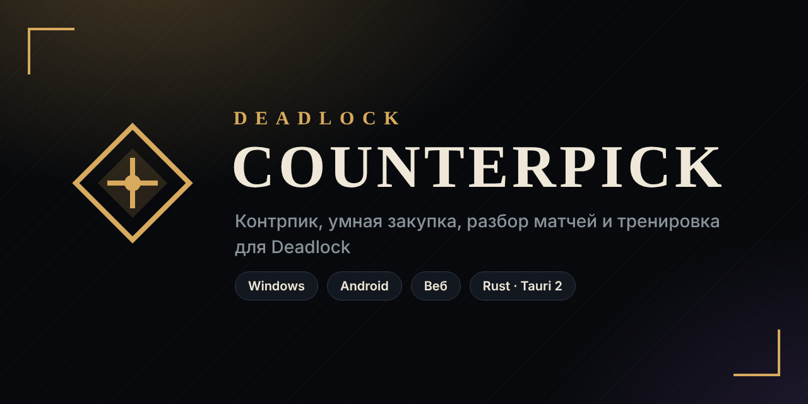
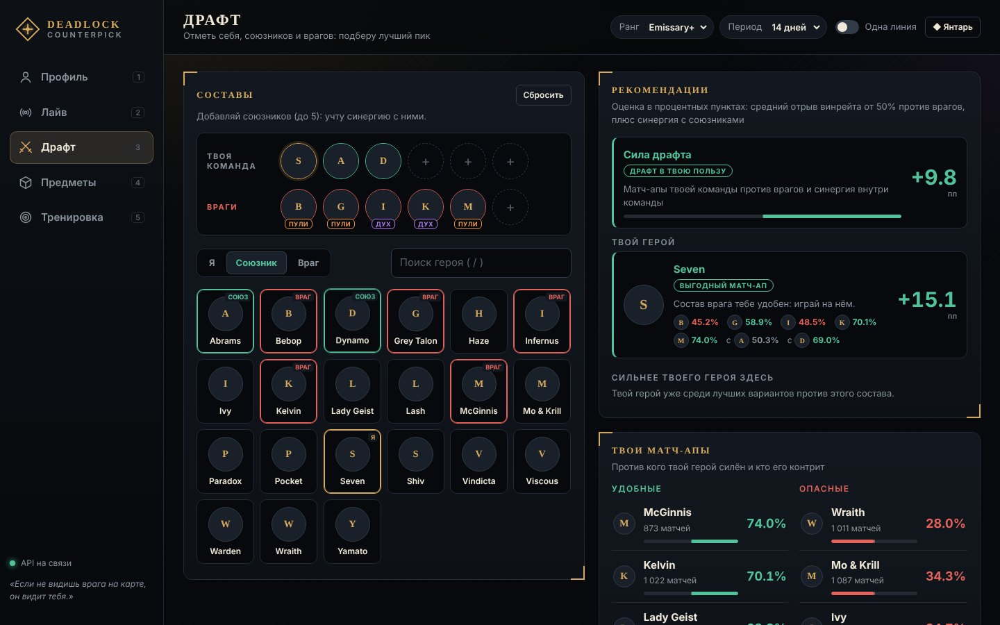
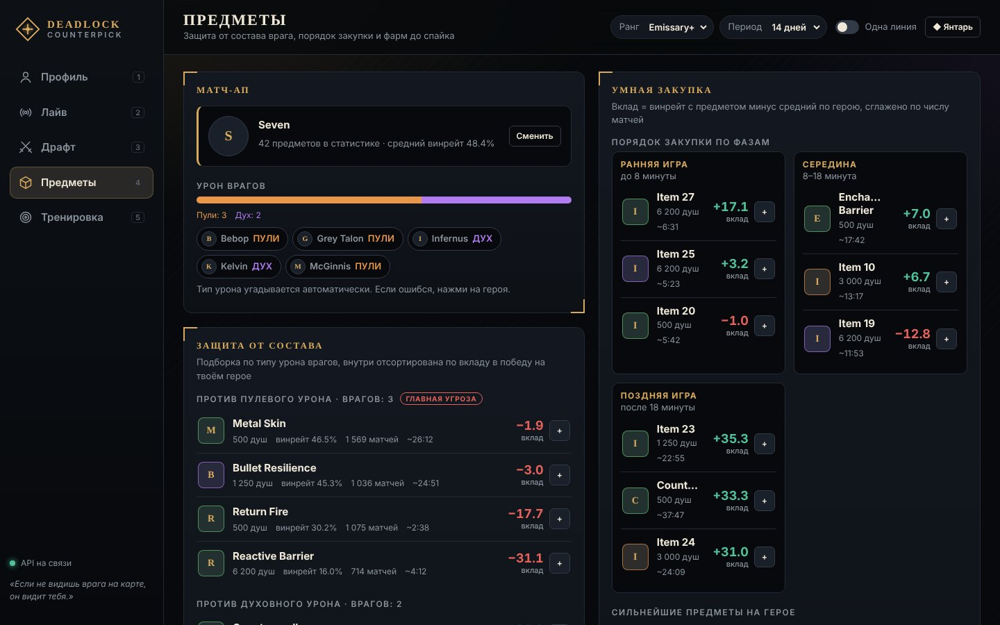
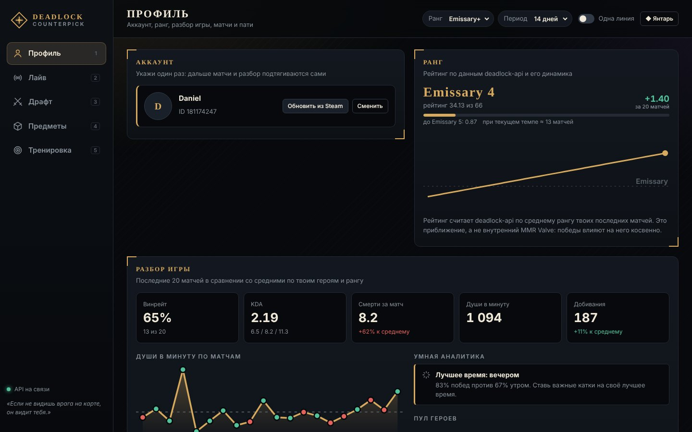
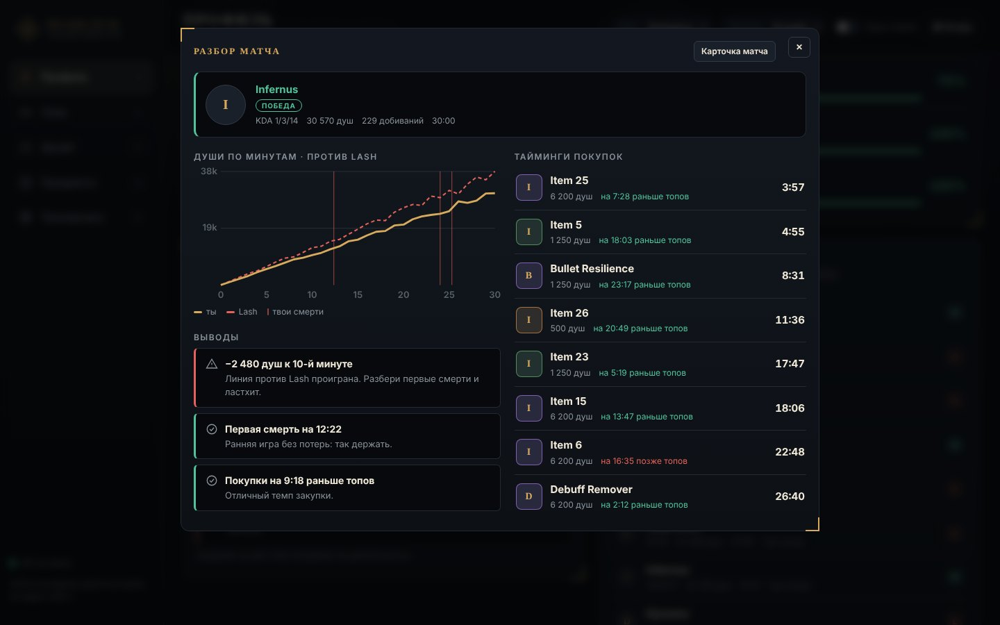
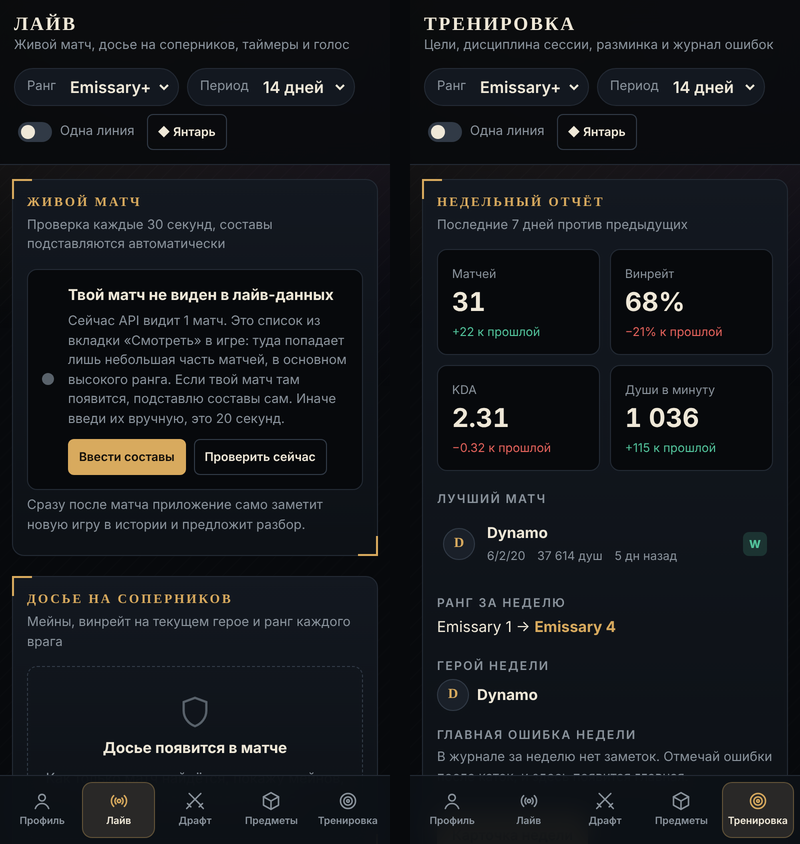

**Контрпик, умная закупка, разбор матчей и тренировка для Deadlock**

[**Скачать**](../../releases/latest) · [Возможности](#возможности) · [Установка](#установка) · [Сборка](docs/BUILD.md)

---

## Возможности

### Драфт
- Составы: ты, до 5 союзников и до 6 врагов
- Лучшие пики по реальной статистике матчей: контрпик врагов плюс синергия с союзниками
- «Сила драфта» и вердикт по твоему герою: выгодный, равный или тяжёлый матч-ап
- Твои удобные и опасные матч-апы
- Фильтры по рангу, периоду и линии

### Предметы
- Защита от состава: против пуль, духа, контроля и лечения, отсортировано по вкладу в победу
- Умная закупка по фазам игры: ранняя, середина, поздняя
- Билд игроков Phantom+ в один клик
- Калькулятор фарма до пауэр-спайка и подсказки, что добавить к билду

### Профиль
- Ранг и его динамика с прогнозом до следующего
- Разбор последних матчей: KDA, души, добивания, тренды и советы
- Умная аналитика: лучшее время для игры, признаки тильта, стабильность фарма
- Сравнение с игроками Phantom+ на тех же героях
- Подробный разбор любого матча: души по минутам против соперника по линии, тайминги покупок против топов
- Пати: общий винрейт с друзьями и лучшие связки героев

### Лайв
- Автоматическое определение матча и подстановка составов (для матчей из вкладки «Смотреть»)
- Досье на соперников: ранг, мейн, винрейт на текущем герое
- Таймеры объектов со звуком, на ПК запускаются клавишами **F6–F10** прямо из игры
- Голосовые подсказки и режим «окно поверх игры»
- **Детектор игры на ПК** (экспериментально): видит запуск Deadlock, героев и номер матча из лога игры

### Тренировка
- Цели, сессия со стоп-лоссом, калькулятор темпа, разминка
- Мета на твоём ранге, журнал ошибок, недельный отчёт и 13 достижений
- Карточки статистики для соцсетей

<table>
<tr>
<td width="50%"></td>
<td width="50%"></td>
</tr>
<tr>
<td></td>
<td></td>
</tr>
</table>

На скриншотах демонстрационные данные.

## Установка

| Платформа | Что скачать | Как поставить |
|---|---|---|
| **Windows 10/11** | `…_x64-setup.exe` | Запусти. Если Windows предупредит: «Подробнее» → «Выполнить в любом случае» |
| **Android 7+** | `DeadlockCounterpick.apk` | Открой файл на телефоне и разреши установку из этого источника |

Файлы лежат в [Releases](../../releases/latest) или во вкладке [Actions](../../actions) → последняя сборка → Artifacts.

### Детектор игры (ПК)
Steam → правый клик по Deadlock → Свойства → Параметры запуска: впиши `-condebug`.
Игра начнёт писать текстовый лог, который читает приложение. Память игры не трогается,
поэтому для аккаунта это безопасно.

## Как это устроено

- **Интерфейс**: один HTML-файл (`dist/index.html`), он же работает как веб-версия
- **Приложение**: Rust + [Tauri 2](https://tauri.app). Горячие клавиши, уведомления, окно поверх игры и детектор игры (`src-tauri/src/game.rs`, с тестами)
- **Сборка**: GitHub Actions собирает Windows и Android при каждом изменении ([подробнее](docs/BUILD.md))
- **Данные**: публичный [deadlock-api.com](https://deadlock-api.com): статистика матчей, ранги, история

## Благодарности

Статистика предоставлена проектом [deadlock-api](https://deadlock-api.com).

Проект не связан с Valve. Deadlock — товарный знак Valve Corporation.

## Лицензия

[MIT](LICENSE) © 2026 Daniel March
